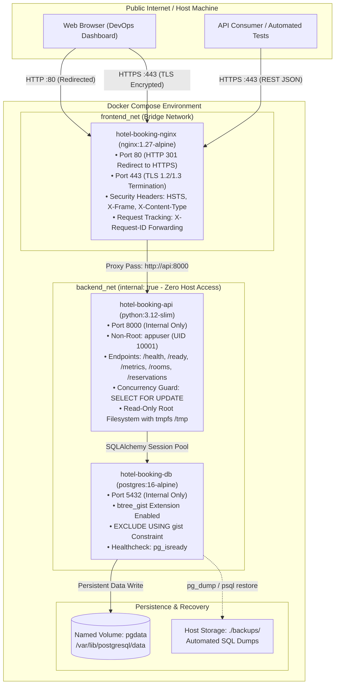
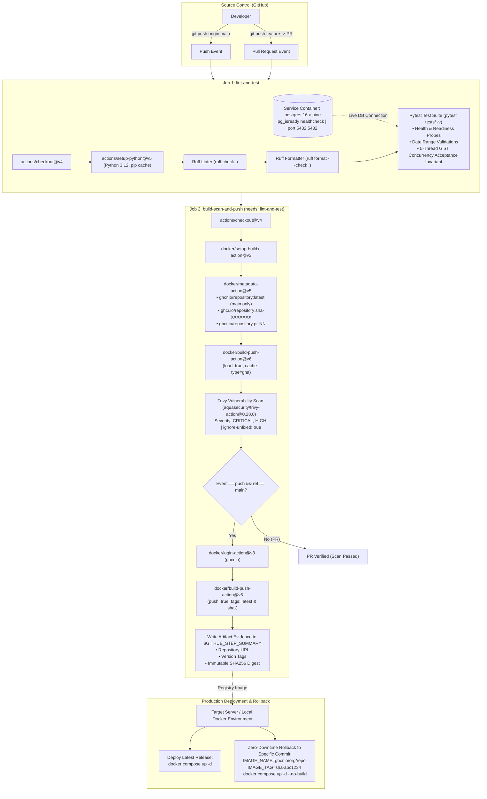

# 🏗️ System & CI/CD Architecture Documentation

This document details the architectural layout, network isolation boundaries, concurrency control design, and automated release pipeline for the **Hotel Room Availability & Reservation Service**.

---

## 1. Runtime & Network Isolation Architecture

The runtime architecture enforces a zero-trust network perimeter using Docker Compose bridge networks. The **Nginx reverse proxy** is the sole service with publicly published ports, shielding internal microservice components from direct public exposure.

### Network Isolation Boundaries & Security Controls

| Security Boundary | Component | Security Control Description |
|---|---|---|
| **Perimeter Entrypoint** | `hotel-booking-nginx` | Sole container publishing host ports (`80`, `443`). Drops cleartext HTTP via 301 redirect. Enforces modern TLS ciphers and HSTS headers. |
| **Service Tier** | `hotel-booking-api` | Exposes internal port `8000` solely to `frontend_net`. Runs as non-root user `appuser` (UID 10001). Write access restricted; volatile data uses `tmpfs: /tmp`. |
| **Database Tier** | `hotel-booking-db` | Located exclusively within `backend_net` (`internal: true`). Host has **no** port mapping or direct route to PostgreSQL port `5432`. |
| **Data Integrity** | PostgreSQL GiST | Automatic initialization of `btree_gist` extension; enforces physical exclusion constraint on `(room_id WITH =, daterange(check_in, check_out, '[)') WITH &&) WHERE (status = 'CONFIRMED')`. |

---

## 2. CI/CD & Automated Rollback Pipeline

The continuous integration and continuous deployment (CI/CD) workflow executes on GitHub Actions. It validates code quality, executes the multi-threaded concurrency test against a live PostgreSQL 16 container, performs static container vulnerability analysis, and publishes versioned images to the GitHub Container Registry (`ghcr.io`).

### Pipeline Security & Invariants

1. **Least-Privilege Token Permissions:** The workflow declares only `contents: read`, `packages: write`, and `security-events: write`.
2. **Deterministic Build Caching:** Buildx uses GitHub Actions cache (`type=gha`) to prevent redundant compilation while ensuring layer determinism.
3. **Security Gate (Trivy):** Vulnerability scanning inspects Debian base layers and Python libraries prior to registry publishing.
4. **Auditability:** Every push to `main` produces an immutable registry digest (`sha256:...`) and commit tag (`sha-<short_sha>`) linked directly in the GitHub Actions step summary.

